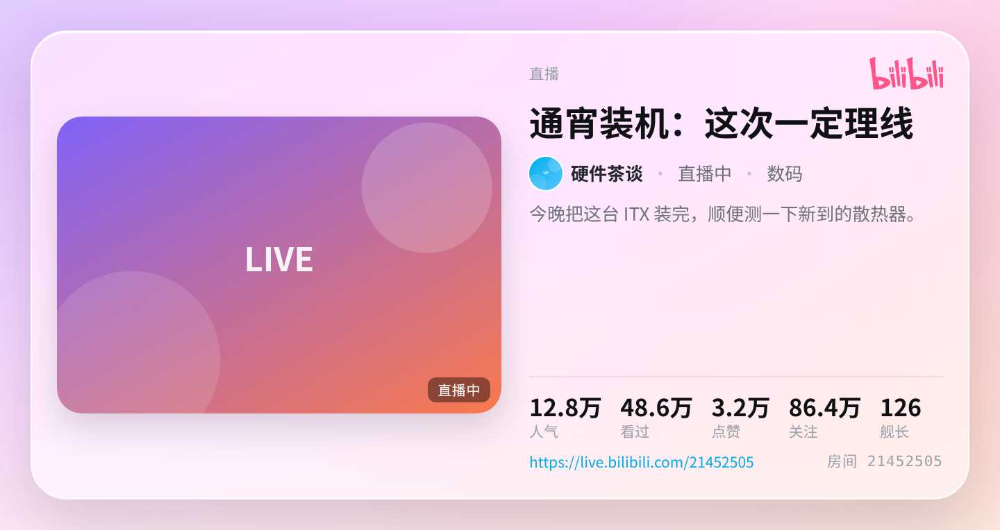
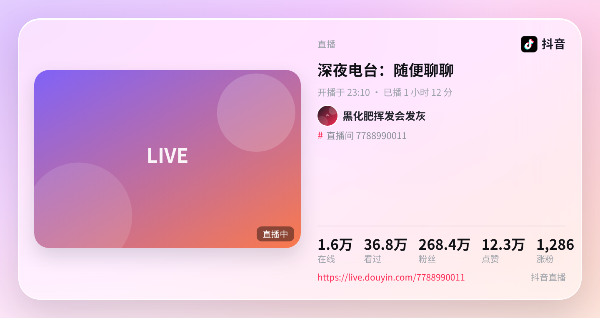

# video-parse-plugin

> 群里有人贴 B 站 / 抖音链接，自动出信息卡片、可选下载视频与评论图；直播间出直播卡片，还能录一小段。


## 预览

| 哔哩哔哩视频卡片 | 抖音图文卡片 |
| --- | --- |
|  |  |
| **哔哩哔哩直播卡片** | **抖音直播卡片** |
|  |  |

## 支持范围

| 平台 | 链接形式 | 发什么 |
| --- | --- | --- |
| 哔哩哔哩 | `BV` 号、`av` 号、`b23.tv` 短链、`bilibili.com` 视频页 | 卡片、可选视频文件、评论图 |
| 哔哩哔哩直播 | `live.bilibili.com/房间号`、`b23.tv` 直播短链 | 直播卡片、可选录制片段 |
| 抖音 | `v.douyin.com` 短链、作品页、整段分享口令 | 卡片、可选无水印视频、评论图 |
| 抖音图文 | 图文作品、动图作品 | 卡片、图片合并转发、动图作品可发原视频、评论图 |
| 抖音直播 | `live.douyin.com/房间号`、直播短链 | 直播卡片、可选录制片段 |

- 同一个群里重复贴同一个作品，冷却时间内只解析一次（可关）。
- 支持群白名单 / 黑名单、私聊开关、消息前缀跳过。
- 卡片、视频、图片、评论图可以合成一条聊天记录（合并转发），也可以逐条直发。

## 工作流程

1. 消息进来，先判断开关、场景、群名单、前缀，再看有没有链接（纯内存判断，不碰网络）。
2. 命中后在消息上回一个「解析中」表情，然后请求平台接口。
3. 渲染卡片；需要的话下载视频、生成评论图。
4. 按配置投递：合并转发或逐条直发，完成后回一个「完成」表情。

## 安装

```bash
# 1. 放进插件目录
git clone <repo> /path/to/yunzai/plugins/video-parse-plugin
cd /path/to/yunzai/plugins/video-parse-plugin

# 2. 装依赖并构建
npm install
npm run build
```

- 需要 Node.js ≥ 20.11。
- 卡片渲染依赖渲染器插件（如 `renderer-puppeteer`）；没有渲染器时自动回落为「封面图 + 文字」。
- 哔哩哔哩登录：私聊机器人发 `#bili登录`，或面板里扫码；登录后能拿到更高画质与完整评论。

## 配置

配置写在 `config/video-parse.yaml`，也可以直接在面板里改。常用项：

| 配置 | 默认值 | 说明 |
| --- | --- | --- |
| `enabled` | `true` | 总开关，关掉后不解析任何链接 |
| `renderCard` | `true` | 渲染卡片图片，失败回落封面 + 文字 |
| `videoMode` | `off` | 哔哩哔哩视频下载档位（画质 + 体积上限） |
| `douyinEnabled` | `true` | 是否解析抖音链接 |
| `douyinVideo` | `off` | 抖音视频下载档位 |
| `douyinImagesAsForward` | `true` | 抖音图片合并转发（一条消息一张） |
| `douyinNoteVideo` | `false` | 动图作品用 Cookie 取原视频一起发 |
| `douyinCookie` | 空 | 抖音 Cookie，填了评论更全、能取动图视频 |
| `commentSend` | `true` | 是否发评论图（两平台共用） |
| `cardAsForward` | `true` | 合并转发总开关 |
| `liveRecord` / `douyinLiveRecord` | `10` | 直播录制秒数，`0` = 只发卡片 |

完整说明见 [USAGE.md](USAGE.md)。

## 命令

| 命令 | 场景 | 说明 |
| --- | --- | --- |
| `#bili登录` | 私聊、仅主人 | 扫码登录哔哩哔哩 |
| `#bili登出` | 仅主人 | 退出登录并删除凭据 |
| `#bili状态` | 任意 | 查看解析统计与登录状态 |

解析本身不需要命令，贴链接就会自动处理。

## 面板

插件自带一个面板扩展页（`webadapter/index.html`），展示解析统计、登录状态、抖音设置、群名单与最近解析记录，支持直接拉黑/放行群、扫码登录。

## 开发

```bash
npm run build     # 编译 src -> dist
npm run typecheck # 只做类型检查
npm test          # 单元测试（node --test）
```

## 目录

```
src/
  handlers/     消息中间件、命令、卡片、评论图、直播投递
  services/     哔哩哔哩 / 抖音接口、登录、Cookie 续期
  utils/        格式化、视频档位、ffmpeg 录制
  types/        数据结构
templates/      卡片 HTML（哔哩哔哩 / 抖音 / 评论 / 直播）
webadapter/     面板扩展页
test/           单元测试
```

## 许可

MIT
