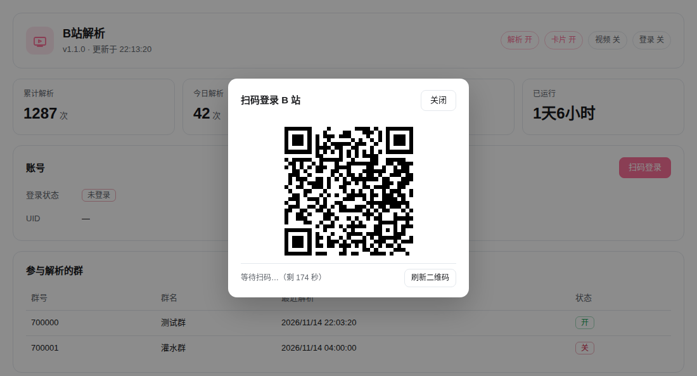
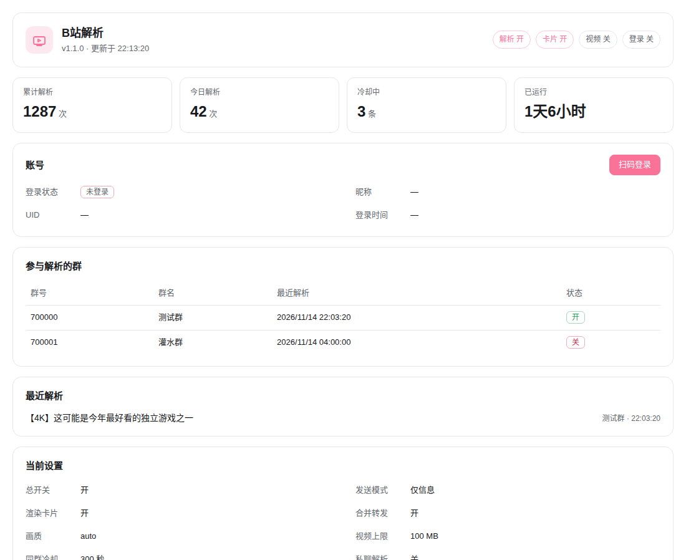

# video-parse-plugin

[Yunzai NG](https://github.com/Yunzai-NG/yunzai-ng) 的 B 站链接解析插件：群里贴 B 站链接，回一张视频卡片，
想连视频一起发也行。

<p align="center">
  
  &nbsp;&nbsp;
  
  &nbsp;&nbsp;
  
</p>

## 功能

- **认得**：站内链接、`b23.tv` / `bili2233.cn` 短链、裸 `BV` / `av` 号、QQ 分享的小程序卡片
- **直播**：`live.bilibili.com` 与直播短链都能认；出直播卡片（封面、主播、标题、分区、人气、看过、点赞、关注、舰长、开播时长），并按配置录一小段发视频
- **卡片**：封面、标题、UP 主、分区、时长、发布日期，播放 / 弹幕 / 点赞 / 投币 / 收藏 / 分享
- **视频**：可选下载，优先 H.264 + AAC，发出去能直接播
- **评论图**：按 B 站评论区原样渲染，条数、排序（热度/时间）、楼中楼条数都能配
- **登录**：网页扫码，登录后支持 1080P60 与 4K，凭据自动续期
- **群白名单 / 黑名单**：只填群号，面板里点选即可；只影响本插件，不拦别的插件
- **抖音**：链接、短链、整段分享口令都能认；出卡片、可选下无水印视频、可发评论图；图文按需合并转发，动图作品可连同原视频一起发；封面按横竖比例自适应，直播链接出直播卡片（在线、看过、粉丝、点赞、涨粉、开播时长），并按配置录一小段发视频

## 安装

```bash
cd <主目录>/plugins
git clone https://github.com/kukukij/video-parse-plugin
cd video-parse-plugin && npm install --omit=dev
```

想要带声音的视频，再装 ffmpeg（按系统挑一行）：

```bash
sudo apt install -y ffmpeg        # Debian / Ubuntu
brew install ffmpeg               # macOS
```

其他系统（dnf / pacman / apk / winget / Termux）见 [USAGE.md](USAGE.md#装-ffmpeg)。

可选：装 [renderer-puppeteer](https://github.com/Yunzai-NG/renderer-puppeteer) 出卡片图，不装回落成
「封面 + 文字」。

装完重启一次，看到 `config/video-parse.yaml` 生成、面板「扩展页面」多一项「视频解析」就对了。

## 配置

面板「插件 → video-parse → 配置」里改，或直接编辑 `config/video-parse.yaml`，**改完即时生效，不用重启**。

| 项 | 默认 | 说明 |
|---|---|---|
| `enabled` | `true` | 总开关 |
| `videoMode` | `off` | 视频下载档位：`off` / `auto` / `480p` / `720p` / `1080p` / `1080p60` / `4k`，每档自带体积上限 |
| `parseInPrivate` | `false` | 私聊也解析 |
| `liveRecord` | `10` | 哔哩哔哩直播录制时长（秒，0-60），`0` 只发直播卡片；录制走 ffmpeg，不转码 |
| `cardAsForward` | `true` | **合并转发总开关**，哔哩哔哩与抖音共用：开着把卡片、视频、图文图片、评论图全部装进同一条转发，关掉逐条直发。转发失败自动回落直发 |
| `commentSend` | `true` | 是否发评论图，两个平台共用 |
| `commentCount` | `10` | 图里放几条主评论（1-20），两个平台共用 |
| `commentSort` | `hot` | `hot` 按热度 / `time` 按时间（仅 B 站） |
| `commentReplyCount` | `2` | 每条评论下带几条回复（0-3），两个平台共用 |
| `commentMinLike` | `0` | 点赞低于此值不显示，0 不过滤，两个平台共用 |
| `commentShowLocation` | `true` | 显示 IP 属地，两个平台共用 |
| `commentShowEmote` | `true` | 显示表情图，两个平台共用 |
| `douyinEnabled` | `true` | 是否解析抖音链接 |
| `douyinVideo` | `off` | 抖音下载档位：`540p` / `720p` / `1080p` / `off` |
| `douyinImagesAsForward` | `true` | 抖音图文图片（最多 9 张）是否做成合并转发（一条消息一张）；总开关也开时，图片/视频做成总转发里的图文转发，总开关关着时单独一条转发 |
| `douyinNoteVideo` | `false` | 图文动图是否取原视频发送；用抖音 Cookie 取作品页，约慢 1–2 秒 |
| `douyinLiveRecord` | `10` | 直播录制时长（秒，0-60），`0` 只发直播卡片；录制走 ffmpeg，不转码 |
| `douyinCookie` | 空 | 抖音登录 Cookie（可选）。实测填不填评论数据一样，主要作用是更抗风控 |
| `parseCacheTTL` | `300` | 同群同视频多少秒内不重复解析，`0` 为不去重 |
| `groupWhitelist` | `[]` | 群白名单，只填群号；留空＝不限群 |
| `groupBlacklist` | `[]` | 群黑名单，只填群号 |

其余配置项见 [USAGE.md](USAGE.md#配置)。

## 使用

**见 [USAGE.md](USAGE.md)**：扫码登录、命令、自动解析规则、群名单、常见问题。

## 许可

MIT。

本插件借鉴自 [napcat-plugin-bilibili](https://github.com/AQiaoYo/napcat-plugin-bilibili)。
